<div align="center">


# `root@cybercommand:~$ whoami`

`CLASSIFICATION: PUBLIC` · `BASE OF OPERATIONS: KENYA 🇰🇪` · `TRAINING: SELF-TAUGHT` · `STATUS: ACTIVE DUTY`

</div>

---

## 🎖️ OPERATOR DOSSIER
```bash
root@cybercommand:~$ cat /classified/dossier.txt
  OPERATOR   : Dan Kamau Mwaura
  CALLSIGN   : STAR2023d
  RANK       : Flutter & Full-Stack Developer
  UNIT       : Independent Cyber Operations
  TRAINING   : Self-taught — no academy, no degree, trained in the field
  BASE       : Kenya
  MISSION    : Build systems that hold the line in the real world.
```

>🪖 **I don't know what's broken in your system. I don't know who wrote it.**
> But I can tell you this: I have no CS degree and no university behind me.
> What I *do* have is a hard-earned arsenal of skills — forged through docs, trial and error, and real projects shipped to real users.
> Skills that make me a nightmare for bugs like yours.
> **I will track the bug down. I will corner it. And I will ship the fix.**

---

## 🛡️ RULES OF ENGAGEMENT
```bash
root@cybercommand:~$ cat /etc/orders.conf
  [ORDER_1] RECON    : Understand the problem before writing a single line.
  [ORDER_2] EXECUTE  : Ship clean, tested, working code.
  [ORDER_3] HOLD     : Maintain it. No system left behind.
```
---
<div align="center">
  
</div>

---

## 🧰 ARSENAL

**`> /primary_weapons`**: Mobile


**`> /sidearms`**: Web


**`> /supply_lines`**: Backend


**`> /field_equipment`**: Systems & Tools


---

## 🗺️ OPERATIONS LOG
```bash
root@cybercommand:~$ ls -la ~/operations
```

| Codename | Objective | Loadout | Status |
|---|---|---|---|
| [`OP_MARKETPLACE`](https://github.com/STAR2023d/REPO_NAME) | E-commerce: products, orders & inventory | Flutter · Serverpod · PostgreSQL | 🟢 `MISSION COMPLETE` |
| [`OP_DAIRY_LINE`](https://github.com/STAR2023d/REPO_NAME) | Milk production tracking per cow | Flutter | 🟢 `MISSION COMPLETE` |
| [`OP_SANA`](https://github.com/STAR2023d/REPO_NAME) | Multi-school CBC system: reports, AI comments, risk engine | React · Supabase | 🟡 `IN THE FIELD` |
| [`OP_HQ`](https://github.com/STAR2023d/my_portfolio) | Personal command centre (portfolio) | React · Vite · Tailwind | 🟢 `MISSION COMPLETE` |

---

## 🎯 SELF-DIRECTED TRAINING
```bash
root@cybercommand:~$ cat /training/log.txt
  INSTRUCTOR : None. Self-commissioned.
  METHOD     : Docs → build → break → fix → ship → repeat
```

---
<div align="center">


</div>

---
## 📡 COMMS CHANNELS

<div align="center">

[](https://dan-kamau-mwaura-portfolio.vercel.app/)
[](https://wa.me/254745514916)
[](mailto:mwauradankamau@gmail.com)


</div>

---
